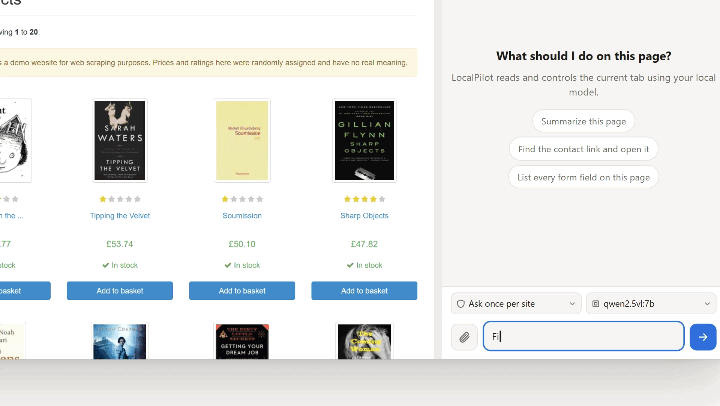
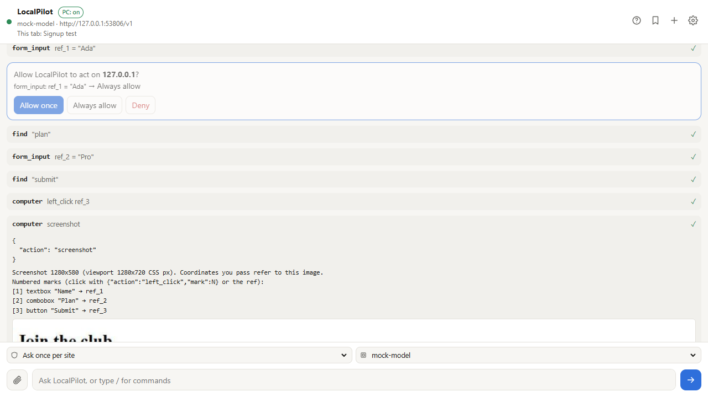

# LocalPilot

<a href="https://fawad1997.github.io/LocalPilot/"></a>

**A browser agent in Chrome's side panel, powered by an AI model on your own PC.** LocalPilot opens pages, reads them, clicks, types, fills forms, saves data to your PC and takes screenshots, while you watch and approve what it does. The model runs **on your computer** (Ollama, LM Studio, llama.cpp, vLLM, LiteLLM, FreeLLMAPI, or any OpenAI/Anthropic-compatible server), so pages and chats never go to a cloud account.

**[▶ Watch the 60-second tour, with sound](https://fawad1997.github.io/LocalPilot/)** · **[Install in 3 steps](#quick-start)**

- **Your real Chrome:** your logins, cookies and tabs; no account, no subscription, no telemetry
- **You stay in control:** it asks before acting on a new site, and you can stop it at any time
- **Opt-in CAPTCHA solver** that runs in your own browser and hands the tab to you when a check needs a person ([tested sites](docs/CAPTCHA.md))
- **Saved tasks on a schedule** that replay their steps without the AI, and notify you when the result changes
- **`/test`** writes a bug report for any site; **`/record`** saves a captioned GIF of a task
- **Works with Claude Code** through an MCP server, with its own tab for each session
- **Status:** 0.10.0 · unpacked extension for Chrome 116+ (Chromium browsers work too) · the PC-bridge installer is Windows-only

## Contents

- [See it work](#see-it-work)
- [Why LocalPilot](#why-localpilot)
- [Quick start](#quick-start)
- [What it can do](#what-it-can-do)
- [CAPTCHA checks](#captcha-checks)
- [How LocalPilot compares](#how-localpilot-compares)
- [Privacy and security](#privacy-and-security)
- [Limitations](#limitations-honest-list)
- [Documentation](#documentation) · [Development](#development) · [License](#license)

## See it work

Every clip was recorded by LocalPilot itself, on real websites. More runs, reports and spreadsheets are in [examples/](examples/README.md).

<table>
<tr><td width="33%" valign="top"><a href="examples/demo-ai/books.md"></a><br><b>“Find the cheapest travel book.”</b><br>Answered £23.21, the lowest of 11 prices.<br><sub>AI agent · 4 tool calls · 20 s</sub></td><td width="33%" valign="top"><a href="examples/demo-ai/form.md"></a><br><b>“Fill this form, but do not submit.”</b><br>Every field filled, then it stopped for review.<br><sub>AI agent · 8 tool calls · 21 s</sub></td><td width="33%" valign="top"><a href="examples/demo-ai/wikipedia.md"></a><br><b>“Who made the first web browser?”</b><br>WorldWideWeb, Tim Berners-Lee, 1990.<br><sub>AI agent · 10 tool calls · 52 s</sub></td></tr>
<tr><td width="33%" valign="top"><a href="examples/demo-ai/bugs.md"></a><br><b>“Test this site and explain the bugs.”</b><br>Two broken images, a failing request, missing alt text, each with a fix.<br><sub>AI agent · /test</sub></td><td width="33%" valign="top"><a href="examples/README.md#2-testing-real-websites-for-bugs"></a><br><b>W3C's “inaccessible” demo site</b><br>103 images without alt text, unlabeled fields, no viewport tag.<br><sub>/test · 4 pages · report + GIF</sub></td><td width="33%" valign="top"><a href="examples/README.md#4-every-check-at-once-a-shop-with-bugs-on-purpose"></a><br><b>A shop with bugs on purpose</b><br>“Price: undefined”, €NaN, a 503 API, a script crash: all found.<br><sub>/test · 9 errors · 4 warnings</sub></td></tr>
<tr><td width="33%" valign="top"><a href="examples/README.md#3-recordings-what-happened-step-by-step"></a><br><b>Search Wikipedia</b><br>Type, open the article, jump to a section.<br><sub>/record · captioned GIF</sub></td><td width="33%" valign="top"><a href="examples/README.md#3-recordings-what-happened-step-by-step"></a><br><b>Fill a form</b><br>Every field and checkbox, a red circle on each click.<br><sub>/record · not submitted</sub></td><td width="33%" valign="top"><a href="examples/real/quotes.csv"></a><br><b>Three pages to a spreadsheet</b><br>Followed “Next” and saved 30 quotes with authors and tags.<br><sub>extract_list · CSV</sub></td></tr>
</table>

---

## Why LocalPilot

| | |
| --- | --- |
| **Private by default.** | The model is yours. Point it at a local server and no page, screenshot or prompt leaves your machine. No account, no cloud dashboard. |
| **Your real browser.** | It works in your normal Chrome profile — your logins, cookies, extensions and tabs — not in a separate automated browser. |
| **You stay in control.** | Approvals per site (allow once / always / deny), “ask before every action”, a plan-first mode, a visible working frame with **Stop**, and a pause card whenever a check needs you. |
| **CAPTCHA solving, locally.** | Off by default. When enabled, it clicks simple checks like a person would — and when it cannot pass one, it stops, tells you, and continues after you solve it. [See the tested sites →](docs/CAPTCHA.md) |
| **More than a browser driver.** | PC files in allowlisted folders, job-board recipes, a website test report, GIF recording, saved tasks on a schedule, and an MCP server for Claude Code. |



*The panel shows every step, asks before acting on a new site, and names the model in use.*

---

## Quick start

### 1. Load the extension

1. Download or clone this folder.
2. Open `chrome://extensions`, turn on **Developer mode**, click **Load unpacked** and pick the folder.
3. Pin LocalPilot and press **Alt+Shift+L** to open the side panel.

### 2. Connect a model

The easiest free setup is Ollama:

```bash
ollama pull qwen2.5vl:7b
setx OLLAMA_ORIGINS "chrome-extension://*"   # Windows; once, then restart Ollama
```

On macOS/Linux, start Ollama with `OLLAMA_ORIGINS="chrome-extension://*" ollama serve` instead.

In the panel: **gear icon → Preset “Ollama (localhost:11434)” → Test & list models → pick a model → Save**.

Any other OpenAI/Anthropic-compatible server works the same way. The full list and troubleshooting are in [docs/REFERENCE.md](docs/REFERENCE.md#local-servers).

### 3. Give it a task

Open a site, open the panel, and type:

> Summarize this page in three bullet points.

Then try: *“Find the contact link and open it.”* · *“Fill this form with my name Jane Doe, but do not submit.”* · *“Save every result on this page as a CSV.”*

> The optional PC bridge (local files) and the MCP server are two short steps: [PC bridge](docs/REFERENCE.md#pc-bridge-files--scripts) · [Claude Code / MCP](docs/REFERENCE.md#claude-code--mcp-phase-2).

---

## What it can do

| Feature | What you get |
| --- | --- |
| **Browse and act** | Navigate, read the page as a compact accessibility tree with reusable refs, click by ref or numbered screenshot mark, type, scroll, handle tabs and dialogs. |
| **Fill forms** | React/Vue inputs, selects, checkboxes and web components; saved values (never shown to the model), password fields refused; the job-application helper stops before submitting. |
| **Collect and export** | Extract repeating lists, read a site's own JSON via captured network responses, write CSV/JSON/Markdown into allowlisted PC folders. |
| **Job search** | Recipes for BOSS直聘, 猎聘, 51job, 智联 and LinkedIn — collected, de-duplicated, saved as CSV with an import draft — plus a guided application filler. |
| **Test a website** | `/test` crawls the site read-only, checks for JS errors, broken links, unlabeled fields, tiny phone layouts and slow pages, then writes a report with screenshots and a GIF. |
| **Record** | `/record …` saves a captioned GIF of the task, with a red circle on every click. |
| **Schedule** | Save a task and run it daily, weekly, every N minutes, or as a page watch that notifies you when something changes. |
| **Drive it from Claude Code** | The MCP server exposes the same browser tools to Claude Code. Each session gets its own tab in one unfocused window, so sessions never take over each other's tabs, or yours. |
| **CAPTCHA checks** | Optional local solver for click-based checks; hands over to you when it cannot pass. [Details →](docs/CAPTCHA.md) |

The complete tool list, every setting and the internals are in [docs/REFERENCE.md](docs/REFERENCE.md).

---

## CAPTCHA checks

**Off by default.** Settings → **Try to solve CAPTCHA checks myself** turns it on. When a check appears, LocalPilot:

1. loads pages with the debugger disconnected, so the challenge runs in a plain browser;
2. finds the real control — in cross-origin frames and closed shadow roots too — and clicks it with a human-shaped mouse path;
3. verifies the page's own success token;
4. **if it cannot pass, stops and shows you the pause card** — solve it in the tab, press **I've solved it, continue**, and the run continues.

| Site (tested 27 Oct 2026) | Check | Result |
| --- | --- | --- |
| [seleniumbase.io/apps/turnstile](https://seleniumbase.io/apps/turnstile) | Cloudflare Turnstile | Passed — green “Success!” |
| [seleniumbase.io/hobbit/login](https://seleniumbase.io/hobbit/login) | Custom “I am not a robot!” | Passed — “Welcome to Middle Earth!” |
| [seleniumbase.io/antibot/login](https://seleniumbase.io/antibot/login) | Brotector CAPTCHA | Passed — “No robots found.” |
| [virtualmanager.com/en/login](https://www.virtualmanager.com/en/login) | Cloudflare interstitial (closed shadow root) | Passed — login form loads |
| [planetminecraft.com/account/sign_in](https://www.planetminecraft.com/account/sign_in) | Inline Turnstile | Passed — sign-in form loads |
| [nowsecure.nl/#relax](https://nowsecure.nl/#relax) | Cloudflare, rotated widget | Flaky — passed 1 of 4 attempts |


*Cloudflare Turnstile on the SeleniumBase demo, passed by LocalPilot.*

It does **not** solve picture grids, Arkose FunCaptcha, Tencent puzzles or logins — those always go to you. Reproduction steps, the full site list and the limits are in **[docs/CAPTCHA.md](docs/CAPTCHA.md)**.

> Use this only on sites you are allowed to automate. CAPTCHA bypass can violate a site's terms of service.

---

## How LocalPilot compares

Short version — the full, sourced comparison is in **[docs/COMPARISON.md](docs/COMPARISON.md)**.

| | LocalPilot | Claude in Chrome | Browser Use |
| --- | --- | --- | --- |
| Model | Yours (local or your endpoint) | Anthropic cloud | Any LLM you configure |
| Account / price | None / free software | Claude account, paid plan | None / MIT library + model costs |
| Runs in your real Chrome | Yes, side panel | Yes, side panel | Library/CLI; cloud browsers otherwise |
| CAPTCHA | **Built-in, local, opt-in, with human fallback** | **Prohibited** (“bypassing bot authorizations”) | None locally; cloud browser feature |
| Local files | Allowlisted folders (PC bridge) | Via Claude Desktop/connectors | Via your code |
| Best for | Private, hands-on automation on your own browser | Polished cloud agent with app knowledge | Programmatic agents and cloud scale |

**Choose LocalPilot** if you want the model and the pages to stay on your machine, an agent you can watch and stop, and CAPTCHA handling with a human fallback.
**Choose Claude in Chrome** for the most polished cloud agent and its Slack/Gmail/Docs knowledge.
**Choose Browser Use** to build browser automation into your own Python/TypeScript system, or to run at cloud scale.

---

## Privacy and security

No account. No telemetry. No LocalPilot server. Pages go only to the model server you configure; diagnostics stay in local files and redact keys, tokens and passwords. The `debugger` permission is what makes trusted clicking possible — Chrome shows its “started debugging this browser” banner while an agent is attached.

What is stored, every permission explained, how to remove everything: **[docs/PRIVACY.md](docs/PRIVACY.md)**.

---

## Limitations (honest list)

- **Local models are smaller than frontier cloud models.** Complex reasoning and long tasks can need a bigger model; the agent is designed to be stopped and corrected.
- **CAPTCHA solving is best-effort.** Cloudflare changes its checks; picture grids and Arkose are out of scope. See [CAPTCHA.md](docs/CAPTCHA.md).
- **It is an unpacked extension.** You install it from a folder, not the Chrome Web Store, so you control the code — and you must reload it after updates.
- **No site-specific app integrations** (Slack/Gmail/Calendar knowledge) like Claude in Chrome has.
- **Automation has consequences.** Purchases, messages and deletions ask for approval by default; “Act without asking” is for sites you fully trust.

---

## Documentation

| Document | Contents |
| --- | --- |
| [docs/REFERENCE.md](docs/REFERENCE.md) | Quick start details, every setting, all tools, recipes, MCP, PC bridge, architecture, tests |
| [docs/CAPTCHA.md](docs/CAPTCHA.md) | How the solver works, tested sites with screenshots, reproduction steps, limits |
| [docs/COMPARISON.md](docs/COMPARISON.md) | Sourced comparison with Claude in Chrome and Browser Use |
| [docs/PRIVACY.md](docs/PRIVACY.md) | Data flow, permissions, PC bridge, MCP, removal |
| [examples/README.md](examples/README.md) | Real runs, reports and GIFs |
| [logs/README.md](logs/README.md) | Diagnostic log format and an AI analysis prompt |

---

## Development

```bash
npm install          # test tools only (playwright-core)
npm test             # unit tests (65)
npm run test:all     # every end-to-end suite (loads the extension in Chromium)
npm run test:e2e:captcha  # the CAPTCHA end-to-end suite
npm run demo         # remakes examples/demo
npm run demo:ai      # remakes examples/demo-ai with your configured model
node scripts/make-readme-preview.mjs   # remakes the README preview from site/media/hero.mp4
```

Project layout, design notes and the full test list are in [docs/REFERENCE.md](docs/REFERENCE.md#layout).

### Repository hygiene

Secrets and machine-specific files are gitignored: `src/local-defaults.json` (your API key), `host/extension-key.pem`, `host/config.json` (use [host/config.example.json](host/config.example.json) as the template), `host/com.localpilot.host.json`, `logs/*.jsonl`, `host/localpilot-host.log`, `bench/results/`. Run `git status` before committing and check that none of them appear.

---

## License

[MIT](LICENSE) © 2026 Fawad Bin Tariq. Use it, modify it, ship it — keep the copyright notice.

Brand names and logos belong to their owners. LocalPilot is not affiliated with Anthropic, Google, or Browser Use. Use it responsibly and only where automation is permitted.
