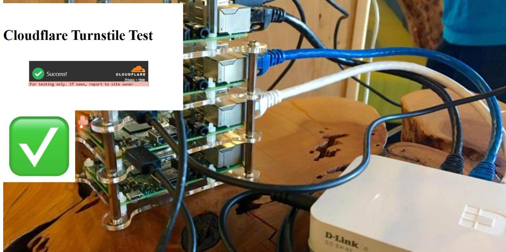
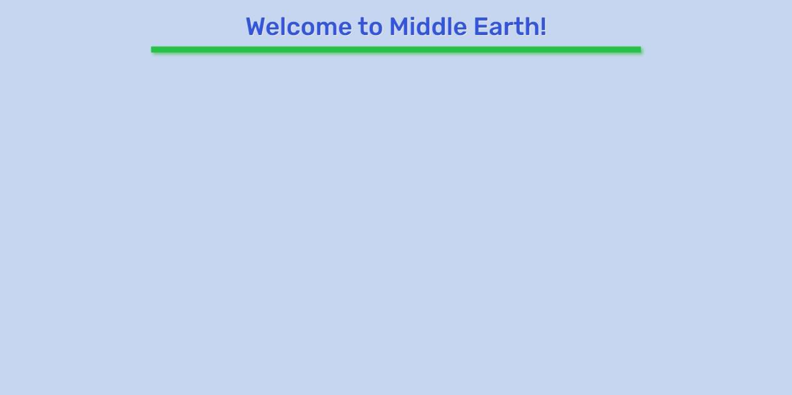
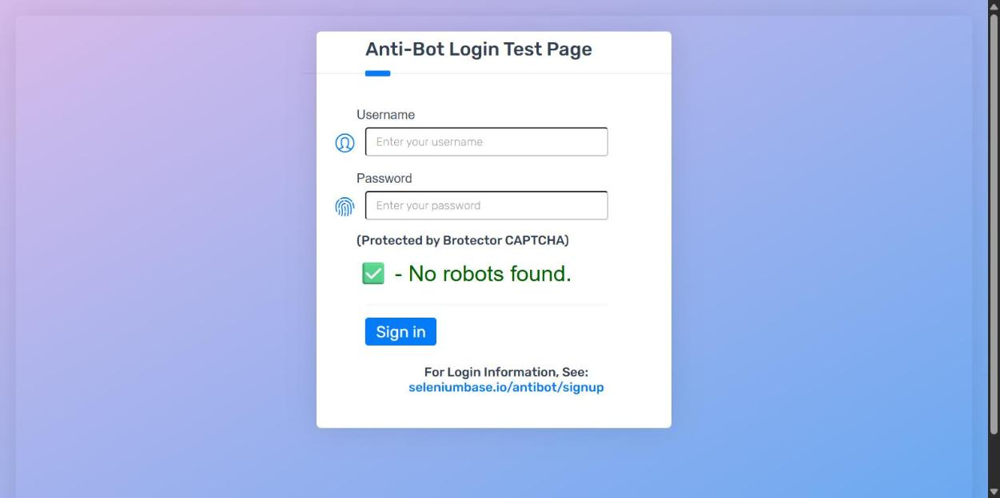
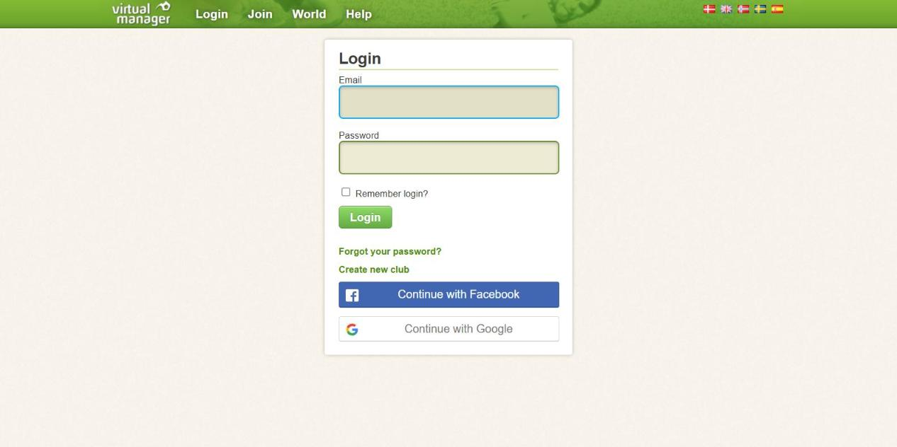
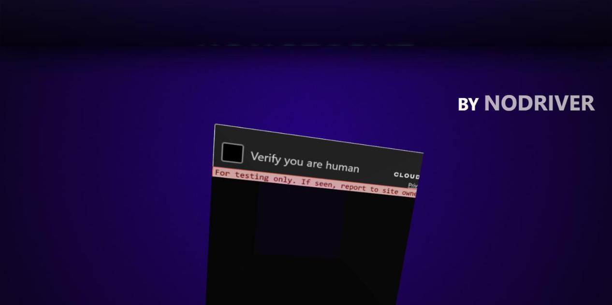

# CAPTCHA solving

LocalPilot can pass **simple, click-based bot checks** — Cloudflare Turnstile and "Verify you are human", reCAPTCHA/hCaptcha checkboxes, sliders, and press-and-hold areas — by clicking them the way a person would.

It is **off by default**. You turn it on in **Settings → Try to solve CAPTCHA checks myself**. When a check cannot be passed, LocalPilot stops and hands the tab to you; after you solve it, the task continues.

> This is a best-effort feature. Cloudflare and similar vendors change their checks often, and a pass is never guaranteed. Use it only on sites you are allowed to automate.

---

## How it works

The approach is a port of SeleniumBase's CDP mode (the engine behind [undetected-testing](https://github.com/mdmintz/undetected-testing)), adapted to a Chrome extension:

1. **The page loads with the debugger detached.** `navigate` drops `chrome.debugger`, lets the page and its first checks run in a plain browser, waits 1.5–3 s, then reconnects. A challenge that runs during load sees no automation channel.
2. **No `Runtime.enable` during a solving run.** Console serialization is the main way Cloudflare/DataDome spot a debugger, so it stays off; `read_console_messages` can turn it on for the rest of the run when you ask.
3. **The real control is clicked.** Every frame is scanned (cross-origin frames included) for Cloudflare's `.cb-lb`/`.cb-i`, reCAPTCHA's `#recaptcha-anchor`, hCaptcha's `#checkbox`, sliders and press-and-hold areas. Widgets hidden in a closed shadow root are found through CDP, which also applies CSS transforms, so a rotated widget still gets the right point.
4. **Human-shaped input.** A curved, eased, jittered mouse path, a hover, a 45–110 ms press, a small drift after release. Sliders are dragged with an overshoot; "press and hold" is held ~10 s.
5. **Success is checked on the page:** a non-empty `cf-turnstile-response` / `g-recaptcha-response` / `h-captcha-response` token, or the challenge disappearing (Cloudflare often just reloads the target page).

Files: [src/captcha.js](../src/captcha.js), [src/human.js](../src/human.js), [src/stealth.js](../src/stealth.js), [src/frames.js](../src/frames.js).

---

## Sites it passed (tested 27 October 2026)

Chrome on Windows, the normal profile with LocalPilot loaded, the solver enabled. Times are wall-clock for the `navigate` call, including the stealth load.

| Site | Check | Result |
| --- | --- | --- |
| [seleniumbase.io/apps/turnstile](https://seleniumbase.io/apps/turnstile) | Cloudflare Turnstile | **Passed**, ~12 s — Cloudflare shows “Success!” |
| [seleniumbase.io/hobbit/login](https://seleniumbase.io/hobbit/login) | Custom “I am not a robot!” button | **Passed**, ~9 s — page advances to “Welcome to Middle Earth!” |
| [seleniumbase.io/antibot/login](https://seleniumbase.io/antibot/login) | Brotector CAPTCHA (“I am not a robot!”) | **Passed**, ~8 s — “✓ No robots found.” |
| [virtualmanager.com/en/login](https://www.virtualmanager.com/en/login) | Cloudflare interstitial, widget in a closed shadow root | **Passed**, ~5 s — login form loads |
| [planetminecraft.com/account/sign_in](https://www.planetminecraft.com/account/sign_in) | Inline Cloudflare Turnstile | **Passed**, ~23 s — sign-in form loads |
| [nowsecure.nl/#relax](https://nowsecure.nl/#relax) | Cloudflare challenge, rotated widget (nodriver demo) | **Flaky**: passed on 1 of 4 attempts (the rest fell back to the pause card) |

Screenshots from those runs:

| | |
| --- | --- |
|  |  |
| Turnstile demo: green “Success!” | SeleniumBase “hobbit” page after the check |
|  |  |
| Anti-bot login: “No robots found.” | Virtual Manager after the Cloudflare interstitial |
|  | |
| nodriver demo: rotated widget passed | |

Two URLs that look like CAPTCHAs but served none: `https://www.bing.com/turing/captcha/challenge` (nothing without a referrer) and `https://www.cloudflare.com/login` (redirects to the dashboard login, no check).

---

## Reproduce it

### 1. Turn the solver on

1. Open the side panel (Alt+Shift+L) → **gear icon** (Settings).
2. Tick **Try to solve CAPTCHA checks myself (Turnstile, reCAPTCHA/hCaptcha boxes, sliders, press-and-hold)**.
3. Click **Save**.

Leave **Pause and hand over to me when a CAPTCHA or bot check appears** ticked: that is the fallback when solving fails.

### 2. Let the agent open the page

The solver runs after page-changing actions (`navigate`, clicks, typing, `read_page`, `find`, `get_page_text`, tab switches). The easiest demo:

> Open `https://seleniumbase.io/apps/turnstile`, wait for the check, then tell me what the page says.

You can also load a site yourself, then ask *“read this page”* — that triggers a check as well.

What you should see: the blue “LocalPilot is working” frame, the mouse path moving to the checkbox, the check turning green, and the tool reply saying the check was solved.

### 3. If it cannot solve it

The orange card appears:

> LocalPilot paused: *site* showed a verification. **LocalPilot tried to solve it, but this one needs you.** Complete it in the tab.

Solve it yourself, press **I've solved it, continue**, and the run continues from the next step. Over MCP/Claude Code the tool result starts with `⚠ BOT CHECK STILL SHOWING (…)` instead.

### 4. Check it from Claude Code (optional)

```bash
claude mcp add localpilot -- node "<project folder>/host/mcp-server.mjs"
```

Then ask Claude Code to open one of the URLs above. The extension does the clicking; Claude only sees tool results.

### 5. Verify in the logs

With **Write diagnostic logs** on, `logs/localpilot-YYYY-MM-DD.jsonl` records `bot_check`, `captcha_click` (provider, frame, point), `captcha_attempt`, `captcha_solved` and `captcha_deep_scan`.

---

## What it cannot solve

The solver never pretends: these are reported as needing you, and the normal pause takes over.

- **Picture grids**: reCAPTCHA image challenges, hCaptcha “click each image”, Turnstile’s image task.
- **Arkose FunCaptcha**, Tencent, NetEase Yidun, AWS WAF puzzles, and other multi-step custom checks.
- **Logins, e-mail/SMS codes, “press and hold” variants that need a specific gesture path** (press-and-hold is attempted, but not every vendor accepts it).
- **Checks on sites that score your browser**: a fresh profile, a real GPU and normal browsing help; no extension can promise a pass.

### If a run pauses at a check

That is the designed behaviour when solving fails, not an error. Solve it in the tab and continue.

---

## Safety and fair use

- Solving CAPTCHAs can violate a site's terms of service. Use this on sites you own, sites you are permitted to automate, or for testing your own bot protection.
- LocalPilot does not hide what it is from **you**: Chrome still shows its “started debugging this browser” banner.
- The solver works locally: it clicks in your browser and calls no CAPTCHA-solving service. Page data reaches only the model server you configured.
