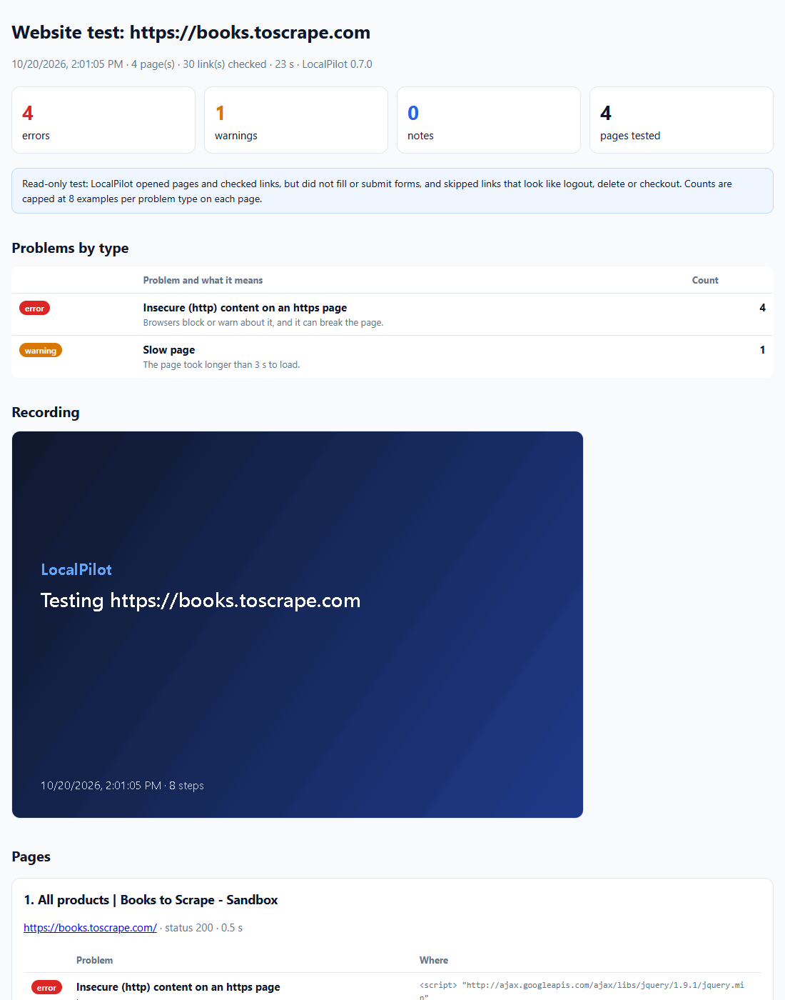

# LocalPilot examples

Real output from LocalPilot, plus prompts you can copy into the side panel. Every file in [`demo/`](demo) was made by LocalPilot's own tools running in Chrome. To make them again yourself, run `npm run demo`; [How these demos were made](#how-these-demos-were-made) explains exactly what that script does.

**Contents**
1. [Testing mode: find bugs on a website](#1-testing-mode-find-bugs-on-a-website)
2. [Testing a real website](#2-testing-a-real-website)
3. [Record what LocalPilot does as a GIF](#3-record-what-localpilot-does-as-a-gif)
4. [Turn any list on a page into a spreadsheet](#4-turn-any-list-on-a-page-into-a-spreadsheet)
5. [More things to try](#5-more-things-to-try)

---

## 1. Testing mode: find bugs on a website

Open the website, then type **`/test`** in the side panel (or ask "Test this website for bugs").

LocalPilot opens the site's pages one by one (it never fills in forms or follows log-out, delete or checkout links). On every page it checks:
- **Code errors:** JavaScript errors and crashes, and failed requests;
- **Broken links and images**, including pages that return 404 or 500;
- **Text that shows a bug:** "undefined", "NaN", "[object Object]" or `{{ template }}` on screen;
- **Accessibility:** form fields without a label, buttons without a name, images without alt text;
- **Phones:** pages too wide for a phone screen;
- **Speed:** slow pages, and insecure `http` content on `https` pages.

It outlines every problem in red, records a GIF, and opens a report.

Below is the test of a small demo shop that has bugs on purpose:


**The report** opens in a new tab and is saved to `Downloads/LocalPilot/`. Each problem type comes with a sentence on what it means.


What LocalPilot told the AI (and the AI then explains in plain words), from [`buggy-shop-result.txt`](demo/buggy-shop-result.txt):

```text
Tested 3 page(s) on http://localhost:8080 in 8 s and checked 3 link(s): 9 error(s), 4 warning(s), 0 note(s).
- [error] Broken image: Image did not load: http://localhost:8080/img/missing.png
- [error] Broken link: http://localhost:8080/sale → 500 (link text "Sale")
- [error] "undefined" / "NaN" / template text on screen: Visible "NaN" in: "€NaN"
- [error] "undefined" / "NaN" / template text on screen: Visible "undefined" in: "Price: undefined"
- [error] Failed request: GET http://localhost:8080/api/cart → 503
- [error] Console error: Cart failed to load: HTTP 503
- [error] Uncaught JavaScript exception: TypeError: Cannot read properties of undefined (reading 'name')
- [warning] Page is wider than a phone screen: At 390px wide the page is 1144px wide <div.promo>
- [warning] Form field without a label: input name="email" placeholder="you@example.com"
…
```

Download [`buggy-shop-report.html`](demo/buggy-shop-report.html) and open it in your browser to see the whole report with screenshots. GitHub shows HTML files as code, not as a page.

**Try it:**
- `/test`
- `/test at most 3 pages, no link check`
- "Test https://my-staging-site.test for bugs and tell me the three most important things to fix."
- "Test this website, then write a bug report for each error in a markdown file in the jobs folder." (needs the PC bridge)

---

## 2. Testing a real website

The same test on [books.toscrape.com](https://books.toscrape.com), a public practice site made for scraping. It found one real problem: every page loads jQuery over `http` on an `https` page, so Chrome blocks the script.




Files: [`books-report.html`](demo/books-report.html), [`books-test.gif`](demo/books-test.gif), [`books-result.txt`](demo/books-result.txt).

---

## 3. Record what LocalPilot does as a GIF

Type **`/record`** followed by a task. LocalPilot records every click, key press, scroll and page change, then saves the GIF to `Downloads/LocalPilot/`. Each frame has a caption with the step ("Click "Travel"") and what the AI said it was doing, and a red circle marks where it clicked.


**Try it:**
- `/record search this site for "pricing" and open the first result`
- `/record fill the contact form with test data, but do not submit`
- Settings → **Record every run as an animated GIF** records everything you ask, without typing `/record`.

Good for bug reports ("here is exactly what happened"), for showing a teammate a workflow, and for checking afterwards what the AI did.

---

## 4. Turn any list on a page into a spreadsheet

Open a page with a list of results, products or rows and ask, for example:

> Save the books on this page as a CSV with title, price, availability and link.

LocalPilot finds the repeating items itself (`extract_list`) and saves them. The first rows of [`books.csv`](demo/books.csv):

| title | price | availability | link |
| --- | --- | --- | --- |
| A Light in the Attic | £51.77 | In stock | https://books.toscrape.com/catalogue/a-light-in-the-attic_1000/index.html |
| Tipping the Velvet | £53.74 | In stock | https://books.toscrape.com/catalogue/tipping-the-velvet_999/index.html |
| Soumission | £50.10 | In stock | https://books.toscrape.com/catalogue/soumission_998/index.html |

It can also follow "Next" buttons or keep scrolling: "Save every result on this page and the next 2 pages as a CSV." Saving a file needs the PC bridge (README, step 4).

---

## 5. More things to try

| You want to… | Type this in the side panel | Needs |
| --- | --- | --- |
| Understand a page quickly | "Summarize this page in five bullet points." | — |
| Compare products | "Open the first three results in new tabs and make a table of price, rating and delivery time." | — |
| Fill a form without sending it | "Fill this form with my name Jane Doe and email jane@example.com, but do not submit." | — |
| Check a page every hour | Saved tasks → **Page watch, no AI**, every 60 min, notify on change. You get a desktop notification when the page changes, at no AI cost. | — |
| Get a morning report | Saved task, **weekdays at 08:00**: "Check my three favourite news sites and list anything about electric bikes." | — |
| Collect job ads | "Get LinkedIn Full Stack Engineer jobs in Amsterdam, 20 jobs." Gives a CSV with the full description of each job. | PC bridge |
| Apply faster | "Fill this application with my CV." It fills the form and attaches the CV, then **stops** for you to check and submit. | PC bridge |
| Teach it a site | "Remember for this site: the search page is /search?q=…" It uses the note on every later visit. | — |
| Use it from Claude Code | "Use localpilot to test http://localhost:3000 for bugs." | Claude Code bridge |

LocalPilot asks before it acts on a new website (unless you choose otherwise), never solves CAPTCHAs, and never types passwords or card numbers.

---

## How these demos were made

`npm run demo` runs [`scripts/make-demo.mjs`](../scripts/make-demo.mjs). It starts Chromium with LocalPilot loaded and calls LocalPilot's tools directly (`test_website`, `gif_recorder`, `find`, `computer`, `extract_list`), so no AI model is needed and the result is the same every time. In normal use the AI model decides which of these tools to call; the tools and their output are the same.

- **Demo shop:** served on your own PC by the script; its bugs are deliberate.
- **Real site:** the other demos use [books.toscrape.com](https://books.toscrape.com), which exists for practising scraping.
- **Offline:** `node scripts/make-demo.mjs --offline` makes only the demo-shop files, without internet.
