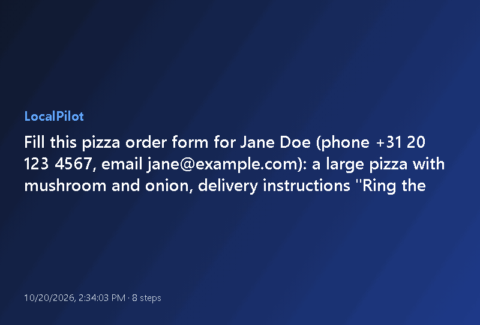
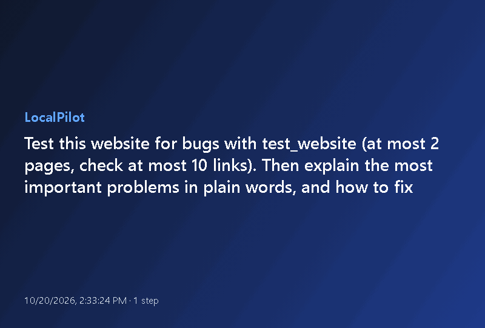
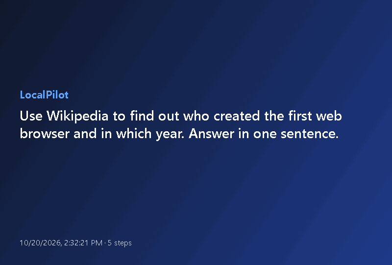
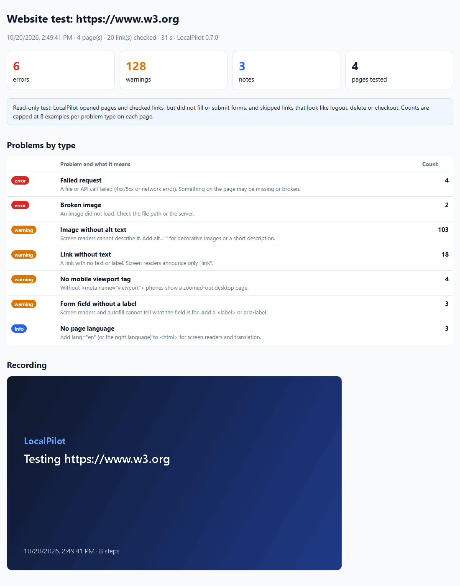
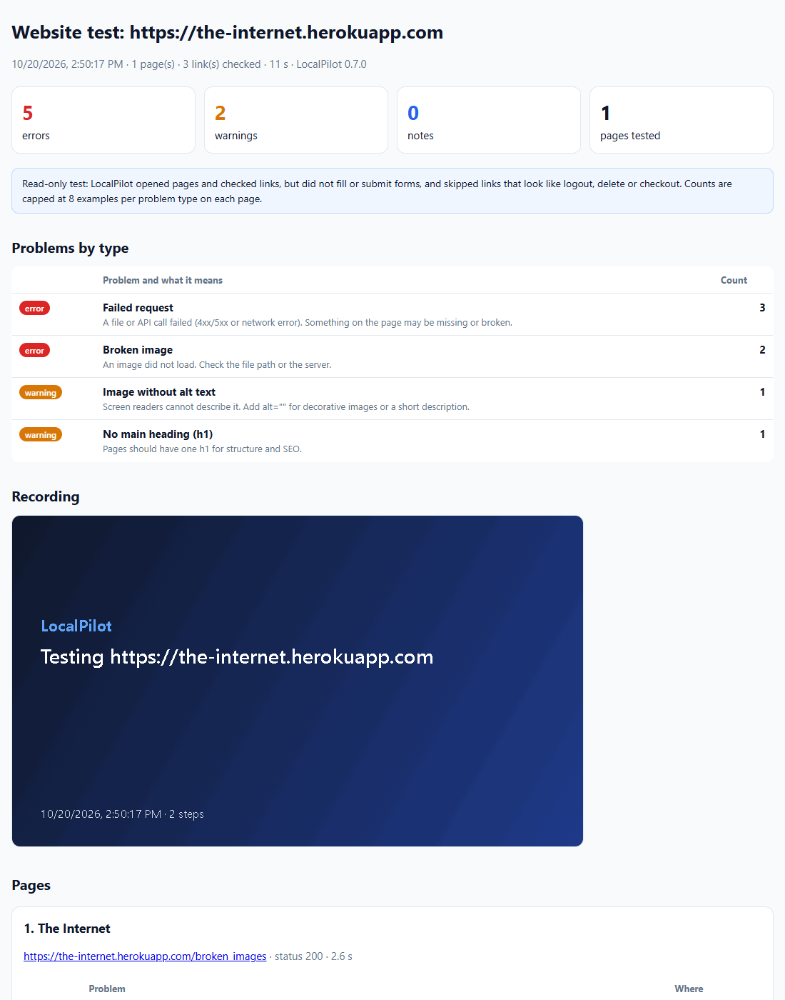
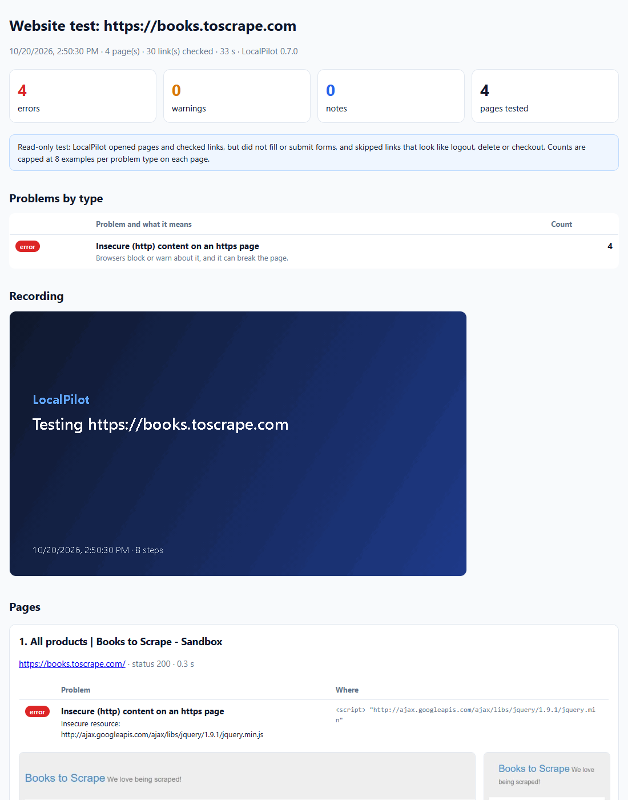
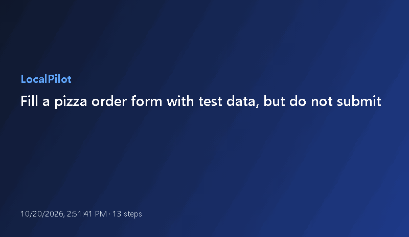
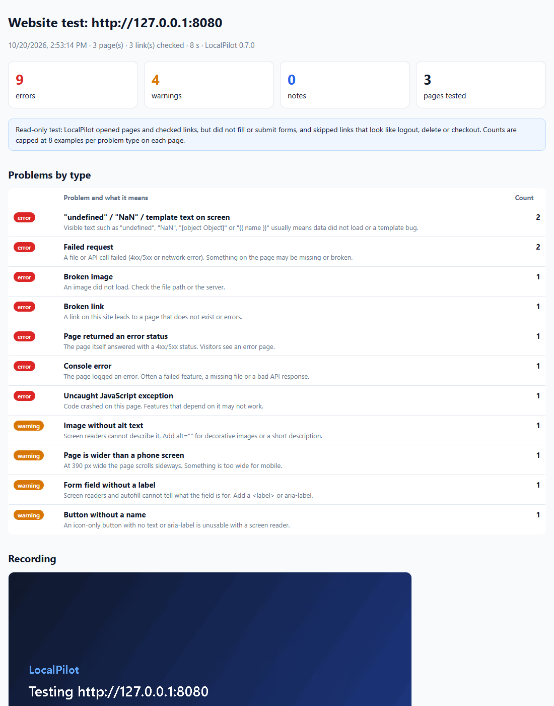

# LocalPilot examples

Every GIF, report and spreadsheet here was made on **real websites**:

- [**LocalPilot's own AI at work**](#1-localpilots-own-ai-at-work). A prompt goes in, and the AI model decides every step by itself.
- [**Testing real websites for bugs**](#2-testing-real-websites-for-bugs) with `/test`.
- [**Recordings**](#3-recordings-what-happened-step-by-step) of browsing, filling in a form and collecting data.
- [**Every check on a demo shop**](#4-every-check-at-once-a-shop-with-bugs-on-purpose) that has bugs on purpose.
- [**More things to try**](#5-more-things-to-try).

Sections 2 and 3 were recorded in Chrome with the LocalPilot extension, driven through its Claude Code bridge (MCP). The sites are public sites made for testing, scraping practice or demonstration, plus Wikipedia. Forms were filled in but never submitted.

---

## 1. LocalPilot's own AI at work

LocalPilot's agent got a single prompt and did the rest itself: it chose the tools, clicked, read pages and answered. **Record every run as a GIF** was on, so each run saved a GIF. The caption under each step shows what the AI said it was doing.

The model was the one configured in LocalPilot's settings: a FreeLLMAPI server on the same PC with its `auto` router. Use any model you like (Ollama, LM Studio, …); see the main README.

### "Find the cheapest book in the Travel category on this site."

**Answer:** *The cheapest book in the Travel category is "The Road to Little Dribbling: Adventures of an American in Britain" with a price of £23.21.* That's correct: it is the lowest of the 11 Travel prices. 4 tool calls, 20 s. [Steps](demo-ai/books.md)

### "Fill this pizza order form for Jane Doe … Do NOT submit the form."

**Answer:** a list of every field it filled, ending with *"I have **not** submitted the form, as requested. You can review it and submit it yourself."* 8 tool calls, 21 s. [Steps](demo-ai/form.md)

### "Test this website for bugs … then explain the most important problems in plain words."

The AI ran the testing mode, then explained what it found:
- two images that return 404;
- a tracking request that fails;
- an image without alt text;
- no main heading.

For each problem it gave a fix (for example `alt="User avatar placeholder"`). 1 tool call, 37 s. [Full answer](demo-ai/bugs.md)

### "Use Wikipedia to find out who created the first web browser and in which year."

**Answer:** *The first web browser, WorldWideWeb (later renamed Nexus), was created by Tim Berners-Lee in 1990.* 10 tool calls, 52 s. [Steps](demo-ai/wikipedia.md)

To make these again with your own model, run `npm run demo:ai` (or `npm run demo:ai -- books`). Small models sometimes take a wrong turn. That is visible in the GIF, which is one reason to record.

---

## 2. Testing real websites for bugs

Open a site and type **`/test`**. LocalPilot opens up to 8 of the site's pages, starting with those in the same folder as the page you're on. It is read-only: no forms are filled in, and log-out, delete and checkout links are skipped.

On each page it checks:
- **Code errors:** JavaScript errors and crashes, and failed requests;
- **Broken links and images**;
- **Text that shows a bug:** "undefined" or "NaN" on screen;
- **Accessibility:** form fields without labels, buttons and links without names, images without alt text;
- **Phones:** pages too wide for a phone;
- **Speed:** slow pages, and insecure content.

Problems are outlined in red. You get a GIF and a report that opens in a new tab.

### W3C's "inaccessible" demo site

The W3C keeps a [deliberately inaccessible demo site](https://www.w3.org/WAI/demos/bad/before/home.html) for teaching. LocalPilot tested 4 of its pages. It found:
- 103 images without alt text, and 18 links without text;
- form fields without labels;
- no mobile viewport tag and no page language;
- two broken images and a missing analytics script.

Files: [report](real/w3c-report.html) (download and open it in a browser; GitHub shows HTML as code), [result for the AI](real/w3c-result.txt).

### A broken-images page (the-internet.herokuapp.com)

[The-internet](https://the-internet.herokuapp.com) is a practice site for test automation. Its `broken_images` page has two images that return 404. LocalPilot reports each one twice: as a broken image, and as the failed request behind it.

Files: [report](real/the-internet-report.html), [result](real/the-internet-result.txt).

### books.toscrape.com

A practice site for scraping. One real problem on every page: jQuery is loaded over `http` on an `https` page, and Chrome blocks it.

Files: [GIF](real/books-test.gif), [report](real/books-report.html), [result](real/books-result.txt).

---

## 3. Recordings: what happened, step by step

Type **`/record`** followed by a task, or turn on **Record every run as an animated GIF** in Settings. Every click, key press, scroll and page change becomes a frame. Each frame has a caption such as `Click "Travel"` or `Tick "Onion"`, and a red circle where the click landed. GIFs are saved in `Downloads/LocalPilot`.

**Search Wikipedia and jump to a section**

**Fill in a form, but do not submit it**

**Browse a shop: category, then product**

**Collect a list over several pages: quotes.toscrape.com → spreadsheet**

`extract_list` read the quotes on three pages, following the "Next" link, and recorded each page. Result: [`quotes.csv`](real/quotes.csv) with 30 rows.

| quote | author | tags |
| --- | --- | --- |
| The world as we have created it is a process of our thinking. It cannot be changed without changing our thinking. | Albert Einstein | change deep-thoughts thinking world |
| It is our choices, Harry, that show what we truly are, far more than our abilities. | J.K. Rowling | abilities choices |

---

## 4. Every check at once: a shop with bugs on purpose

This one is **not** a real website. A small shop served on your own PC has one of each bug planted on purpose:
- "Price: undefined" and "€NaN" on screen;
- a missing image, a cart API that returns 503, and a console error;
- a script crash, a "Sale" page that returns 500;
- a banner too wide for phones, a field without a label, and an icon button without a name.

LocalPilot finds them all: 9 errors and 4 warnings. Run `npm run demo` to make it again; no internet or AI model is needed.

---

## 5. More things to try

| You want to… | Type this in the side panel | Needs |
| --- | --- | --- |
| Understand a page quickly | "Summarize this page in five bullet points." | — |
| Compare products | "Open the first three results in new tabs and make a table of price, rating and delivery time." | — |
| Fill a form without sending it | "Fill this form with my name Jane Doe and email jane@example.com, but do not submit." | — |
| Test your own site before a release | `/test`, or "Test http://localhost:3000 for bugs, at most 10 pages." | — |
| Show someone how to do something | `/record open the settings page and turn on dark mode` | — |
| Check a page every hour | Saved tasks → **Page watch, no AI**, every 60 min, notify on change. A desktop notification when the page changes, at no AI cost. | — |
| Get a morning report | Saved task, **weekdays at 08:00**: "Check my three favourite news sites and list anything about electric bikes." | — |
| Save a list as a spreadsheet | "Save every result on this page and the next 2 pages as a CSV." | PC bridge |
| Collect job ads | "Get LinkedIn Full Stack Engineer jobs in Amsterdam, 20 jobs." | PC bridge |
| Apply faster | "Fill this application with my CV." It fills the form and attaches the CV, then **stops** for you to check and submit. | PC bridge |
| Teach it a site | "Remember for this site: the search page is /search?q=…" | — |
| Use it from Claude Code | "Use localpilot to test http://localhost:3000 for bugs." | Claude Code bridge |

LocalPilot asks before it acts on a new website (unless you choose otherwise), never solves CAPTCHAs, and never types passwords or card numbers.
